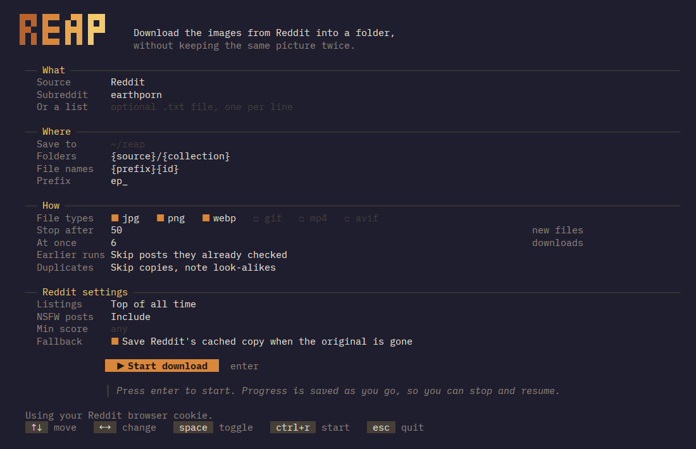

# 📊 Reap

This is a scraping tool I made for work and am doing a bit of revamping on. I don't plain to maintain *this* scraper, but given that I'm still keen on collecting more data, I'll likely create a better version using some of the things I learned.

Given that I'm not maintaining this, feel free to make a PR, fork, etc. and I will happily review it; however don't rely on me for product support

## Features
- Concurrency: Users can define the amount of goroutines they want concurrently fetching data. However many workers are set is however many files will be downloaded concurrently
- Deduplication and perceptual hashing: Uses Hamming distance, perceptual hashing, and SHA256 to deduplicate images. This allows a virtually completely unique dataset of files.
- Abstracted plugin and resolver framework: Never touch the engine or actual code, just define a resolver or source, the fetching code, and have fun with whatever you scrape.
- TUI: in-terminal interface for interacting with Reap. Recommended
- CLI: commandline interface for Reap.

It's really fast. The implementation of Goroutines allowed me to source ~10,000 unique images from Reddit in around 5 minutes @ 9000 Mbps internet speeds. Speeds should still be smooth and quick at slower internet speeds as well.
